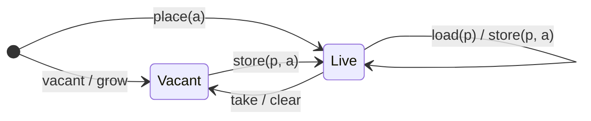

# pointer stateとresponsibility

Status: Exploratory support document

この文書は、`*A`が指すplaceの状態遷移とresponsibilityの移動を定める。状態の意味は
[pointerとIxPoolの意味論](semantics.md)、実行時の順序は
[runtime contract](../runtime/contract.md#responsibility)を正とする。

## 状態遷移

pointeeは内部状態として`Vacant | Live(A)`を持つ。この和はsource valueではなく、`isLive`と各formの
preconditionを説明する状態である。



| form | 前後 | responsibility |
|---|---|---|
| `isLive(p)` | 状態を変えない | なし |
| `load(p)` | Live → Live | pointeeをShareして返す |
| `store(p, a)` | Vacant → Live | `a`をStoreして保持する |
| `store(p, a)` | Live → Live | `a`をStoreして保持し、旧値をDropする |
| `take(p)` | Live → Vacant | pointeeを結果へMoveする |
| `clear(p)` | Live → Vacant | pointeeをDropする |
| placeの終了 | Liveなら終了 | pointeeをDropする |

load、take、clearはLiveをpreconditionとする。storeは両状態で使え、初期化と置換を一つの意味に
まとめる。置換では新しい値をplaceへ確立してから旧値をDropする。

Live同士の`swap(p, a)`を追加するなら、旧値をresultへMoveし、aをplaceへMoveするoperationとして定義できる。
`clear(p)`は`take(p)`のresultをDropしたもの、`transfer(from, to)`は`store(to, take(from))`と同じ意味である。

## IxPoolから得たpointer

`at(pool, i)`はcoordinate iのplaceへの到達性をShareして返す。pointeeをShareするのではない。返した
pointer carrierはpool ownerへのresponsibilityを持ち、元のIxPool handleが終了してもpointerを有効に保つ。

```text
IxPool handle ─┐
*A at(i)      ─┼─▶ pool identity ─▶ coordinate i ─▶ Vacant | Live(A)
*A at(j)      ─┘
```

growthでbacking storageが移っても、pointer carrierはownerとcoordinateから現在のstorageを引き直す。物理
payload pointerをcarrierへ恒久的にcacheしてはならない。

## container内の移動

値を複製せずplace間で移す基本形は次である。

```mal
store(destination, take(source));
```

sourceはLiveを要求する。destinationがVacantなら単純なMove、Liveなら旧値のDropを伴う。穴を移動するheapや
DequeではdestinationをVacantに保つinvariantをcontainer側が持てる。

unknown user codeを呼び得るShareまたはDrop glueの前にはcontainer invariantを復元する。初回採択で
callback/reentryを認めないなら、その制限をexternとeffectの規則として別に定め、pointer stateへ埋め込まない。
